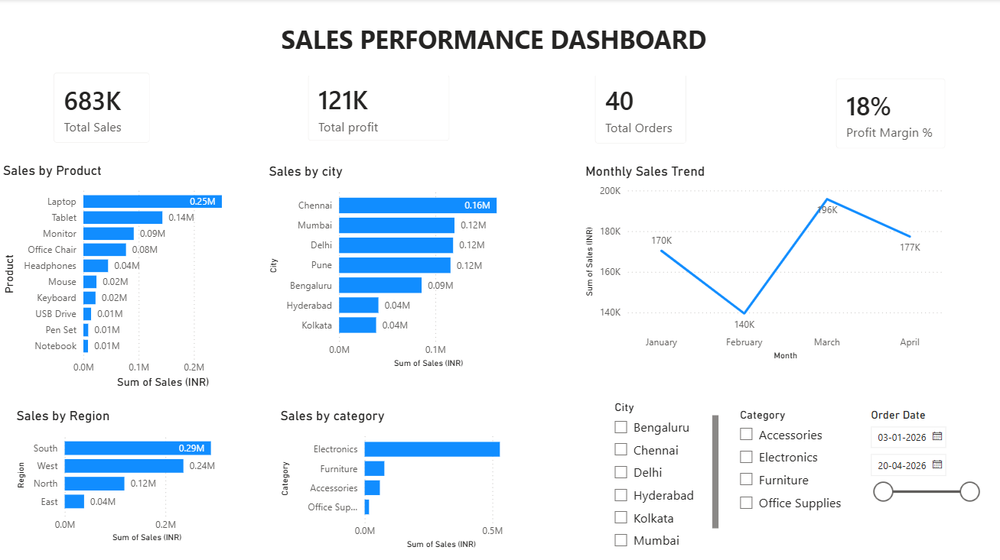

# Sales Performance Dashboard (Power BI)

An interactive Power BI dashboard built on a sample sales dataset of 40 orders (Jan to Apr 2026). This is a practice project to learn dashboard design and DAX measures.

## What the dashboard shows
- KPI cards: Total Sales (683K), Total Profit (121K), Total Orders (40), Profit Margin (18%)
- Sales by Product
- Sales by City
- Sales by Region
- Sales by Category
- Monthly Sales Trend
- Slicers for City, Category and Order Date

## Tools used
- Power BI Desktop
- DAX
- Excel (data source)

## Key insights
- Laptops have the highest sales among all products (about 0.25M).
- The South region leads in sales (about 0.29M), followed by West (about 0.24M).
- Electronics is the top-selling category.
- Chennai is the top city by sales (about 0.16M).
- Sales dropped to about 140K in February, then peaked at about 196K in March.

## Dashboard preview

## Files in this repository
- `Sales_Dashboard.pbix` : Power BI report file
- `power_bi_sales_dashboard_dataset.xlsx` : sample dataset
- `Dashboard.png` : screenshot of the dashboard

## Note
The data is a sample dataset created for practice. It does not contain any real customer or company information.
